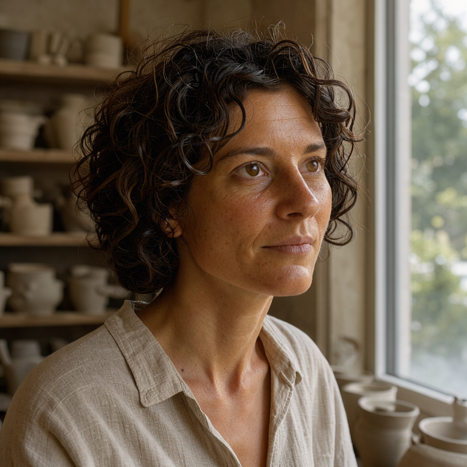
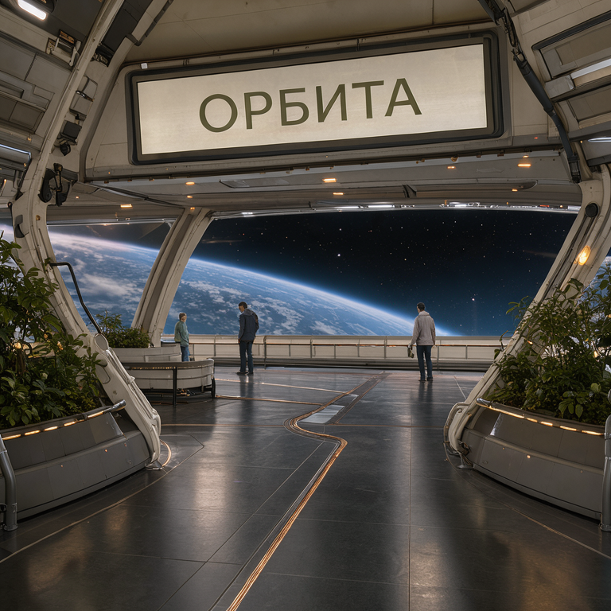
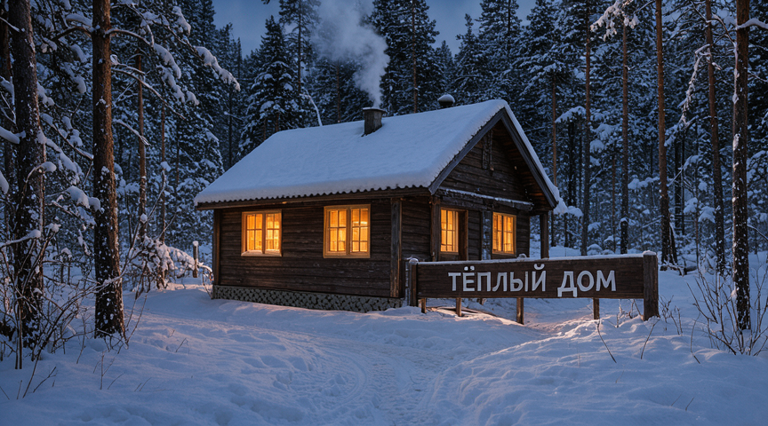
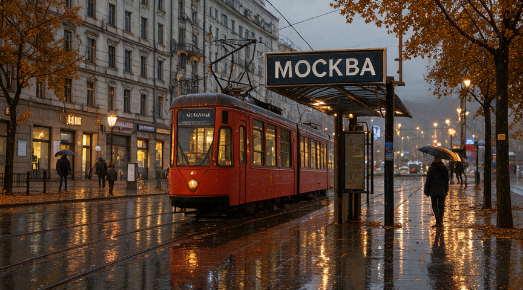
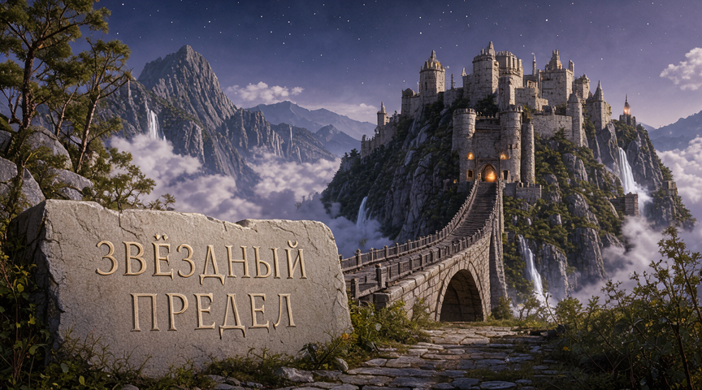
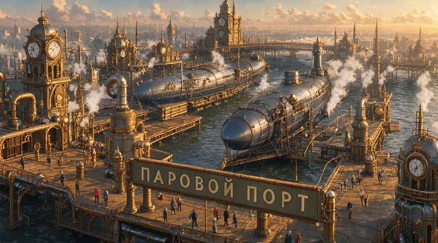
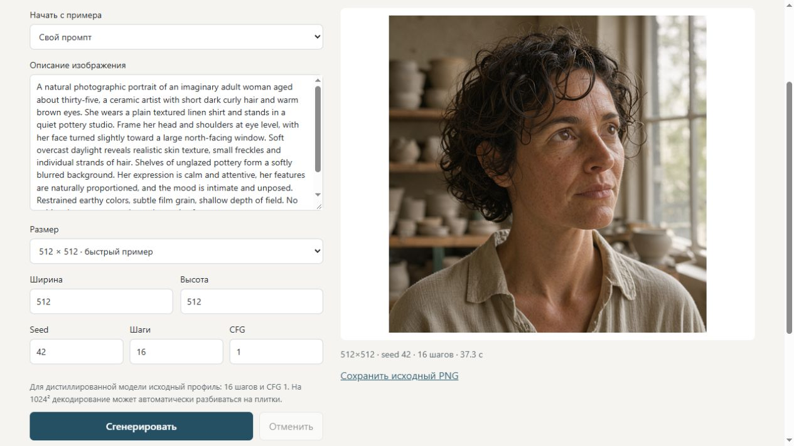

# FLUX.3 Image Klein on a GTX 1070 Ti 8 GB

**Language / Язык:** [Русский](README.md) · **English**

**Preview release 0.1.0-preview.** The server and image generation have been checked programmatically. The complete workflow through the native Manager buttons and installation on a clean machine have not been verified.

Reproducible image generation on Windows and Pascal sm_61: stable-diffusion.cpp CUDA 12, FLUX.3 Q4_0, Qwen3-VL 4B Q4_K_M and FLUX.2 VAE. Measurements used the existing CUDA Toolkit 12.6.85 installation. The graphical Manager reuses existing CUDA 12 libraries or downloads local libraries when needed. PyTorch is not required.

The current app UI is in Russian. The full report and setup/interface guides are available in Russian and English; other linked documentation may be in Russian. Original Cyrillic text inside images is preserved. The language buttons inside either downloaded report also work offline.

- [Download the standalone interactive report](https://github.com/DevelopmentOpenworld/flux3-pascal-8gb/releases/download/v0.1.0-preview/FLUX3-Pascal-Report-EN.html) · [Русский HTML](https://github.com/DevelopmentOpenworld/flux3-pascal-8gb/releases/download/v0.1.0-preview/FLUX3-Pascal-Report-RU.html) – six themes, battle comparisons and resolution comparisons.
- [Exact files, versions, SHA256 and commands](docs/REPRODUCE_EN.md).
- [Local generator](docs/INTERFACE_EN.md) – settings and a single current result.
- [All battle controls](docs/BATTLES.md), [gallery](docs/GALLERY.md), [CSV](results.csv), [JSON](results.json).

## Report excerpts: images and measurements

**[Download the full interactive report →](https://github.com/DevelopmentOpenworld/flux3-pascal-8gb/releases/download/v0.1.0-preview/FLUX3-Pascal-Report-EN.html)** · [All images and observations](docs/GALLERY.md) · [Results table](docs/RESULTS.md)

Below are six examples from different themes and a separate battle recheck. The complete corpus retains the first results of 39 predefined conditions, including failures. These examples come from a limited sample and do not guarantee quality for arbitrary prompts. Click an image to open its original PNG.

**Profile used for these images:** GTX 1070 Ti 8 GB, Windows 10, 32 GiB RAM; FLUX.3 Q4_0, 16 steps, CFG1, Euler/discrete, seed42 and a 6 GiB engine VRAM budget. Time includes loading the weights in a new process and saving the PNG. The Windows file cache was not cleared. “Card VRAM” is the highest total occupied VRAM observed at roughly one-second intervals, including the desktop.

<table>
<tr>
<td width="50%" valign="top">
<p><strong>People · Portrait of a craftswoman</strong></p>
<a href="results/batch-people-portrait/image.png"></a>
<p><strong>59.2 s</strong> · 768×768 · card VRAM: 5408 MiB</p>
<p>Face, skin texture and lighting. The hands are outside the frame.</p>
<p><a href="prompts/people-portrait.txt">Prompt</a> · <a href="results/batch-people-portrait/record.json">Parameters and measurements</a></p>
</td>
<td width="50%" valign="top">
<p><strong>High-tech · Orbita Station</strong></p>
<a href="results/batch-hitech-location/image.png"></a>
<p><strong>60.3 s</strong> · 768×768 · card VRAM: 5402 MiB</p>
<p>The Cyrillic sign reads “ОРБИТА”; the panoramic window and planet are present. The sign dominates the composition.</p>
<p><a href="prompts/hitech-location.txt">Prompt</a> · <a href="results/batch-hitech-location/record.json">Parameters and measurements</a></p>
</td>
</tr>
<tr>
<td width="50%" valign="top">
<p><strong>Rural landscape · Winter house by the forest</strong></p>
<a href="results/batch-rural-winter/image.png"></a>
<p><strong>46.4 s</strong> · 864×480 · card VRAM: 4539 MiB</p>
<p>The sign reads “ТЁПЛЫЙ ДОМ” (“Warm home”), with snow and warm window light.</p>
<p><a href="prompts/rural-winter.txt">Prompt</a> · <a href="results/batch-rural-winter/record.json">Parameters and measurements</a></p>
</td>
<td width="50%" valign="top">
<p><strong>Urban landscape · Moscow after the rain</strong></p>
<a href="results/batch-urban-moscow/image.png"></a>
<p><strong>49.1 s</strong> · 864×480 · card VRAM: 4539 MiB</p>
<p>The sign reads “МОСКВА”, with a tram and reflections. This is an illustrative setting, not a verified depiction of a real street.</p>
<p><a href="prompts/urban-moscow.txt">Prompt</a> · <a href="results/batch-urban-moscow/record.json">Parameters and measurements</a></p>
</td>
</tr>
<tr>
<td width="50%" valign="top">
<p><strong>Fantasy · Star Frontier</strong></p>
<a href="results/batch-fantasy-location/image.png"></a>
<p><strong>43.1 s</strong> · 864×480 · card VRAM: 4539 MiB</p>
<p>The long Cyrillic inscription is readable; the two mountain peaks and waterfalls are not fully represented.</p>
<p><a href="prompts/fantasy-location.txt">Prompt</a> · <a href="results/batch-fantasy-location/record.json">Parameters and measurements</a></p>
</td>
<td width="50%" valign="top">
<p><strong>Steampunk · Steam Port</strong></p>
<a href="results/batch-steampunk-location/image.png"></a>
<p><strong>43.0 s</strong> · 864×480 · card VRAM: 4819 MiB</p>
<p>The sign reads “ПАРОВОЙ ПОРТ”, with airships and steam. The plausibility of the mechanisms has not been verified.</p>
<p><a href="prompts/steampunk-location.txt">Prompt</a> · <a href="results/batch-steampunk-location/record.json">Parameters and measurements</a></p>
</td>
</tr>
</table>

### How generation time changes with resolution

The same portrait uses the same prompt, seed42, 16 steps and CFG1. These are three individual measurements, not averages of repeated runs.

| Resolution | Time, s | Sampled card VRAM, MiB | Source data |
|---|---:|---:|---|
| 512×512 | 30.9 | 4733 | [PNG](results/batch-people-portrait-512/image.png) · [Measurements](results/batch-people-portrait-512/record.json) |
| 768×768 | 59.2 | 5408 | [PNG](results/batch-people-portrait/image.png) · [Measurements](results/batch-people-portrait/record.json) |
| 1024×1024 | 130.1 | 5322 | [PNG](results/batch-people-portrait-1024/image.png) · [Measurements](results/batch-people-portrait-1024/record.json) |

At 1024², the engine automatically reduced the VAE decoding tile size; that extra time is included. Across the first 18 thematic scenes, 14 results finished within 60 s. The [full report](https://github.com/DevelopmentOpenworld/flux3-pascal-8gb/releases/download/v0.1.0-preview/FLUX3-Pascal-Report-EN.html) includes other scenes, resolutions and parameters.

### Battles: a clearer grip does not mean the whole scene is correct

Both pairs below use seed42 and 864×480. The revised prompts simplify the composition: the knights lose the shield, and the robots’ shield and staff are replaced by two swords. This compares different conditions and does not demonstrate a complete fix for the original complex action.

<table>
<tr>
<td width="50%" valign="top">
<p><strong>Battle on a fortress bridge · original prompt</strong></p>
<a href="results/batch-fantasy-battle/image.png"></a>
<p><strong>42.7 s</strong> · 864×480 · card VRAM: 4545 MiB</p>
<p>Original scene: the right-hand warrior’s sword floats without a visible grip. Overall: FAIL.</p>
<p><a href="prompts/fantasy-battle.txt">Prompt</a> · <a href="results/batch-fantasy-battle/record.json">Parameters and measurements</a></p>
</td>
<td width="50%" valign="top">
<p><strong>Battle on a fortress bridge · simplified prompt</strong></p>
<a href="results/battle-fantasy-clear-42/image.png"></a>
<p><strong>45.4 s</strong> · 864×480 · card VRAM: 4761 MiB</p>
<p>Revised scene: both sword grips are readable, but the left-hand character uses the wrong anatomical hand. Overall: FAIL.</p>
<p><a href="prompts/fantasy-battle-clear.txt">Prompt</a> · <a href="results/battle-fantasy-clear-42/record.json">Parameters and measurements</a></p>
</td>
</tr>
<tr>
<td width="50%" valign="top">
<p><strong>Clash of machines · original prompt</strong></p>
<a href="results/batch-hitech-battle/image.png"></a>
<p><strong>42.6 s</strong> · 864×480 · card VRAM: 4698 MiB</p>
<p>Original scene: weapons and hands overlap; the weapon construction and ownership are not reliably readable. Overall: FAIL.</p>
<p><a href="prompts/hitech-battle.txt">Prompt</a> · <a href="results/batch-hitech-battle/record.json">Parameters and measurements</a></p>
</td>
<td width="50%" valign="top">
<p><strong>Clash of machines · simplified prompt</strong></p>
<a href="results/battle-robot-clear-42/image.png"></a>
<p><strong>47.5 s</strong> · 864×480 · card VRAM: 4717 MiB</p>
<p>Revised scene: hand–hilt–blade continuity is readable, but the left-hand robot uses the wrong hand and the figures are cropped at the bottom. Overall: FAIL.</p>
<p><a href="prompts/robot-battle-clear.txt">Prompt</a> · <a href="results/battle-robot-clear-42/record.json">Parameters and measurements</a></p>
</td>
</tr>
</table>

None of the eight revised battle images received a full PASS. Visual assessment was performed by the AI author; no independent assessment was carried out. [All battles, seeds 42/7/123 and criteria](docs/BATTLES.md) are retained with the original prompts and PNGs.

**[Full HTML report: theme filters, paired comparisons, resolutions and all 39 runs →](https://github.com/DevelopmentOpenworld/flux3-pascal-8gb/releases/download/v0.1.0-preview/FLUX3-Pascal-Report-EN.html)**. Download the HTML and open it locally; viewing its source on GitHub does not run the interactive report.

## Install and launch without a console

[Download Windows Manager](https://github.com/DevelopmentOpenworld/flux3-pascal-8gb/releases/download/v0.1.0-preview/FLUX3-Manager-Windows-x64.zip), extract the entire ZIP and open **FLUX3-Manager.exe**. Python is included. Choose a storage folder; select existing engine files, weights and CUDA using **Browse… («Обзор…»)**, or choose **Download missing files («Скачать недостающее»)**. The Manager checks the pinned SHA256 values and saves the settings.

**Start server («Запустить сервер»)**, **Open generator («Открыть генератор»)** and **Stop server («Остановить сервер»)** control the app from the Manager window. Closing the Manager stops its server. In the generator, choose a preset or enter a prompt, set the size, seed, steps and CFG, then click **Generate («Сгенерировать»)**. The default address is `127.0.0.1:8440`; the local session persists between restarts. [Step-by-step guide](docs/INTERFACE_EN.md).

For developers, `Start-FLUX3.cmd` / `python scripts/app.py` is also available; launch the native Manager from source with `python desktop/launcher.py`. Windows Python 3.14.4 x64 / Tcl-Tk 8.6 was tested; the app uses the standard library. [Building the Windows EXE](docs/BUILD_WINDOWS.md) is a separate process; the package excludes models and CUDA.

The app shows one current operation. **Save the PNG before the next generation or before exiting.** The next generation removes the previous result from the temporary working folder; normal app shutdown removes that folder entirely. Previously saved user folders are neither read nor deleted. Restarting the server starts with an empty result.

The random session, configuration and launcher state remain local and are excluded from Git and distribution packages. The Manager uses `%LOCALAPPDATA%/FLUX3Pascal`; the source server uses the selected configuration directory. The public project includes no machine-specific configuration. The browser’s **Exit app («Завершить приложение»)** button also closes the server; closing only the browser tab leaves the current operation running.



## Tested components and settings

GTX 1070 Ti 8192 MiB, compute capability 6.1, driver 581.80; Intel i7-7700, 8 logical threads; 32695 MiB RAM; Windows 10 22H2 build 19045.6466. CUDA Toolkit 12.6.85 was already installed.

Engine: stable-diffusion.cpp `master-992-39bc9d0`, commit `39bc9d0b4bad86750fcb1fd2d711bc57a4c6018f`. Weights: `flux3-image-klein-Q4_0.gguf`, `Qwen3VL-4B-Instruct-Q4_K_M.gguf`, `flux2-vae.safetensors`. Exact hashes are in [assets.lock.json](assets.lock.json).

Measured profile: 16 steps, CFG1, Euler/discrete, `--max-vram 6 --mmap --offload-to-cpu --flash-attn off,diffusion=on`. Model and engine code were not modified. This route does not require FP8/NVFP4 or Tensor Cores. Model weights, CUDA and the engine are not included in the repository or Windows package; Python/Tk and their libraries are included in the Windows package with their licenses.

## Control corpus

The corpus retains 39 fixed research runs: 18 initial thematic scenes, 6 resolution conditions, 1 Toolkit-only check, 12 additional battles and 2 generator UI control runs. These are predefined reproducible materials with prompts and SHA256 values.

14 of the first 18 thematic scenes finished within a minute. Additional 864×480 battles took 40.8–47.5 s. At 1024², generation took 130–141 s, including automatic VAE retries with smaller tiles. The highest sampled occupied VRAM across the corpus was 5728 MiB, including the desktop. The Windows file cache was not cleared.

The original battle images have weapon defects. In six simplified duels, the grips became clearer, but the character on the left used the wrong anatomical hand. In two aerial battles, the main beam is readable, but its attachment is incorrect. None of the eight revised images received a full PASS. All first results are retained, without retouching or cherry-picking successful seeds.

The official prompt upsampler was not used: the engine received detailed English scene descriptions written in advance. Quality was assessed by the AI author; there was no independent assessment. Other GPUs/operating systems, minimum RAM, cold-cache behavior, training, LoRA, editing and 4K were not tested.

## Commands

```powershell
Copy-Item -LiteralPath config.example.json -Destination config.local.json
# Set the paths to existing files and the CUDA bin directory.
python scripts/verify.py --config config.local.json
python scripts/generate.py --config config.local.json --case people-portrait-512 --run-id local-portrait-001
```

Checks without running the model:

```powershell
python scripts/verify.py
python -B -m unittest discover -s tests -v
```

Rebuild the standalone report from the stored control corpus:

```powershell
python scripts/build_report.py --seal
python scripts/verify.py
```

[MIT](LICENSE) covers this project’s own code and documentation. Image usage terms depend on the model; MIT does not relicense model outputs. External component terms are listed in [THIRD_PARTY.md](THIRD_PARTY.md); primary sources are in [SOURCES.md](SOURCES.md).

[First public release](https://github.com/DevelopmentOpenworld/flux3-pascal-8gb/releases/tag/v0.1.0-preview) · [Release description (Russian)](RELEASE_NOTES.md) · [Package SHA256 values](https://github.com/DevelopmentOpenworld/flux3-pascal-8gb/releases/download/v0.1.0-preview/SHA256SUMS.txt).

Download the HTML and open it locally; GitHub’s normal HTML source view does not run the interactive report.
