# Перепроверка боёв

Три исходные сцены, 12 новых условий. Матрица battle-cases.json и её SHA зафиксированы до новых запусков; все первые результаты оставлены. Для фэнтези и роботов сохранены парные seed 42/7/123 исходного и упрощённого промптов. Для стимпанка – исходный seed42 и два уточнённых условия 42/7.

connection проверяет читаемость связи оружия и руки либо основного луча с источником/целью. instruction проверяет другие конкретные условия: контакт, анатомическую сторону руки, состав оружия, кадрирование и место крепления. overall не получает PASS, если хотя бы одна обязательная часть нарушена или остаётся неоднозначной. PASS означает только видимую связность на данном PNG; физическая конструкция фантастического оружия не доказана. Это исследовательская визуальная оценка автора ИИ после просмотра, не независимая или статистическая метрика.

Упрощение меняет саму задачу: у рыцарей убран щит, у роботов щит и посох заменены двумя мечами; композиция стала статичнее. Поэтому улучшение хвата нельзя считать исправлением исходного сложного действия без потерь.

## battle-fantasy-clear-7

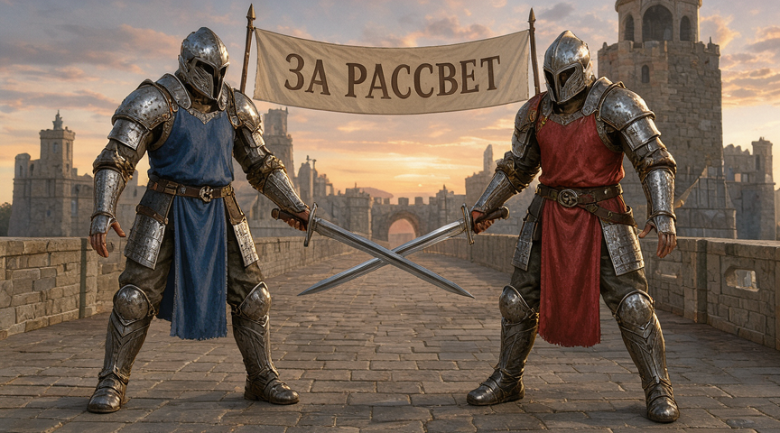

45.44 с; connection=PASS; instruction=FAIL; overall=FAIL.

У обоих персонажей видна непрерывная связь кисти, рукояти и клинка; подвешенного оружия не видно. Однако персонаж слева держит меч левой анатомической рукой вместо заданной правой. Фигуры помещаются целиком, но композиция стала статичной и упрощённой.

[Точный промпт](../prompts/fantasy-battle-clear.txt) · [Параметры](../results/battle-fantasy-clear-7/record.json)

## battle-fantasy-clear-42

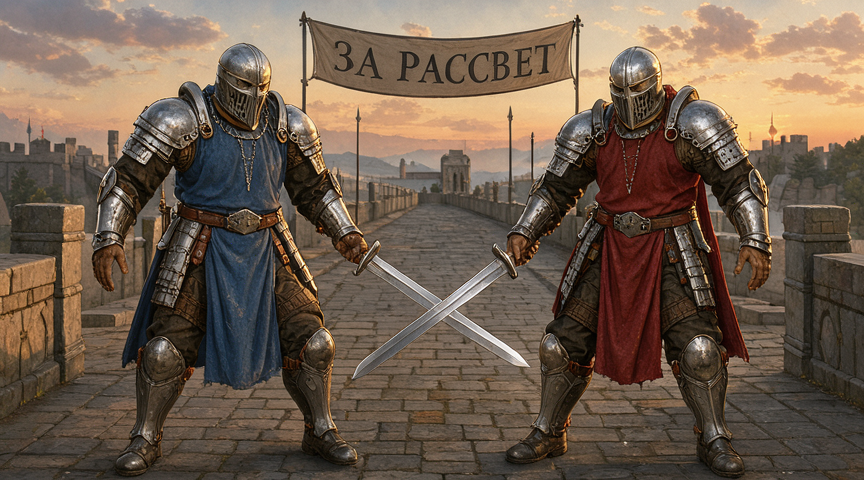

45.40 с; connection=PASS; instruction=FAIL; overall=FAIL.

У обоих персонажей видна непрерывная связь кисти, рукояти и клинка; подвешенного оружия не видно. Однако персонаж слева держит меч левой анатомической рукой вместо заданной правой. Фигуры помещаются целиком, но композиция стала статичной и упрощённой.

[Точный промпт](../prompts/fantasy-battle-clear.txt) · [Параметры](../results/battle-fantasy-clear-42/record.json)

## battle-fantasy-clear-123

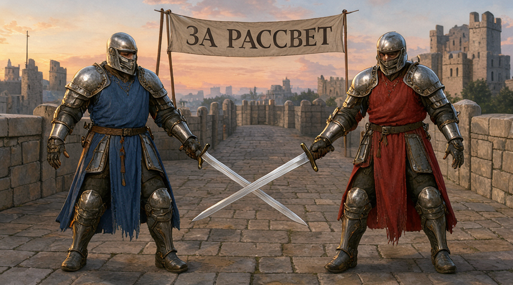

45.80 с; connection=PASS; instruction=FAIL; overall=FAIL.

У обоих персонажей видна непрерывная связь кисти, рукояти и клинка; подвешенного оружия не видно. Однако персонаж слева держит меч левой анатомической рукой вместо заданной правой. Фигуры помещаются целиком, но композиция стала статичной и упрощённой.

[Точный промпт](../prompts/fantasy-battle-clear.txt) · [Параметры](../results/battle-fantasy-clear-123/record.json)

## battle-fantasy-original-7

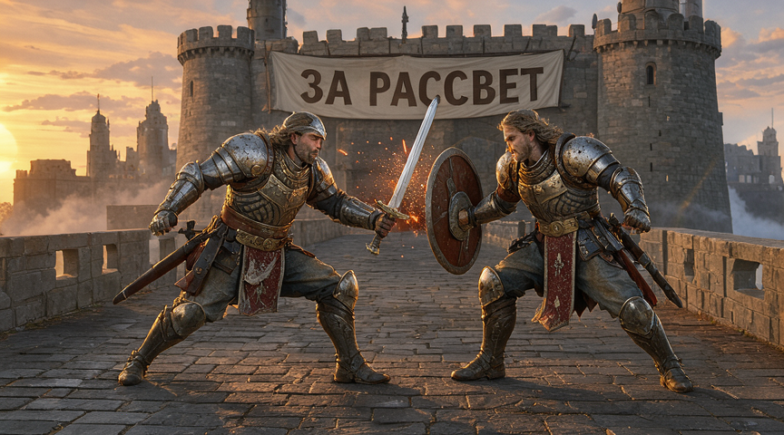

40.79 с; connection=PASS; instruction=FAIL; overall=FAIL.

Левый воин держит меч, правый держит щит. Явно подвешенного меча нет, но клинок и щит разделены видимым зазором; искры не подтверждают контакт. Смена seed устранила один дефект, не обеспечив выполнение сцены.

[Точный промпт](../prompts/fantasy-battle.txt) · [Параметры](../results/battle-fantasy-original-7/record.json)

## batch-fantasy-battle

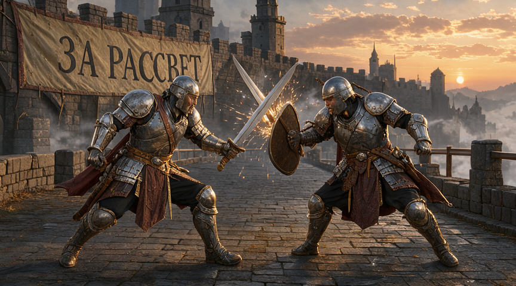

42.68 с; connection=FAIL; instruction=FAIL; overall=FAIL.

У правого воина кисти заняты щитом и опущенной рукой, а отдельный меч висит между фигурами без хвата. Это подтверждает замечание о неподдерживаемом клинке; кадр не проходит проверку физической связности.

[Точный промпт](../prompts/fantasy-battle.txt) · [Параметры](../results/batch-fantasy-battle/record.json)

## battle-fantasy-original-123

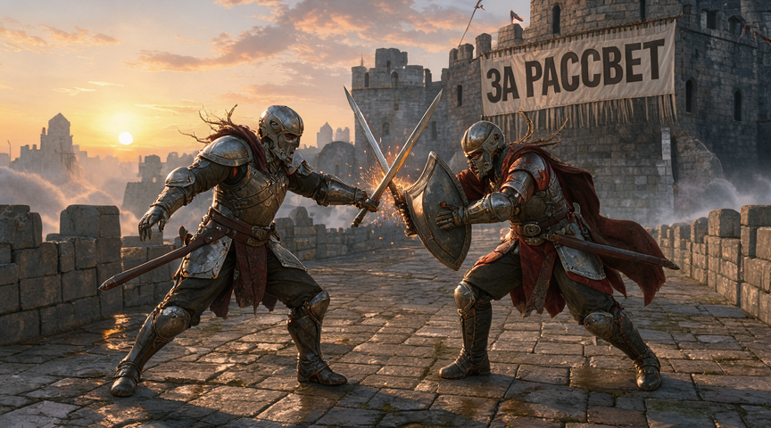

42.11 с; connection=UNCERTAIN; instruction=UNCERTAIN; overall=UNCERTAIN.

Второй клинок выходит из области за щитом, где хват закрыт и неоднозначен. Нельзя уверенно проследить отдельную кисть–рукоять–клинок у правого воина. Не засчитан как корректный бой.

[Точный промпт](../prompts/fantasy-battle.txt) · [Параметры](../results/battle-fantasy-original-123/record.json)

## battle-robot-clear-7

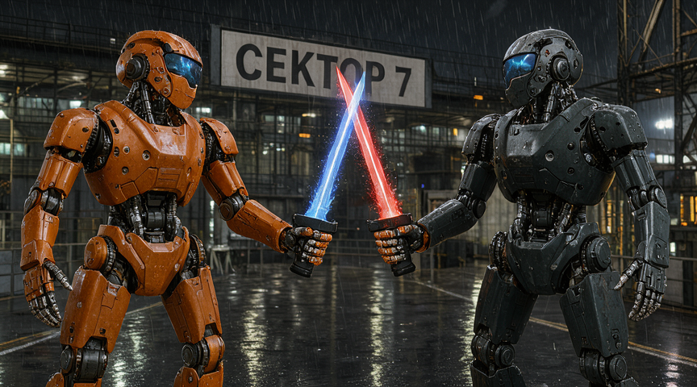

46.22 с; connection=PASS; instruction=FAIL; overall=FAIL.

У обоих персонажей видна непрерывная связь кисти, рукояти и клинка; подвешенного оружия не видно. Однако персонаж слева держит меч левой анатомической рукой вместо заданной правой. Фигуры дополнительно обрезаны снизу, хотя требовались полные тела.

[Точный промпт](../prompts/robot-battle-clear.txt) · [Параметры](../results/battle-robot-clear-7/record.json)

## battle-robot-clear-42

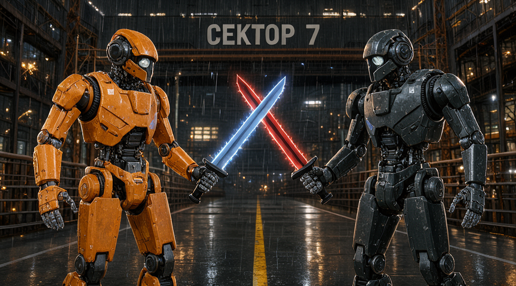

47.50 с; connection=PASS; instruction=FAIL; overall=FAIL.

У обоих персонажей видна непрерывная связь кисти, рукояти и клинка; подвешенного оружия не видно. Однако персонаж слева держит меч левой анатомической рукой вместо заданной правой. Фигуры дополнительно обрезаны снизу, хотя требовались полные тела.

[Точный промпт](../prompts/robot-battle-clear.txt) · [Параметры](../results/battle-robot-clear-42/record.json)

## battle-robot-clear-123

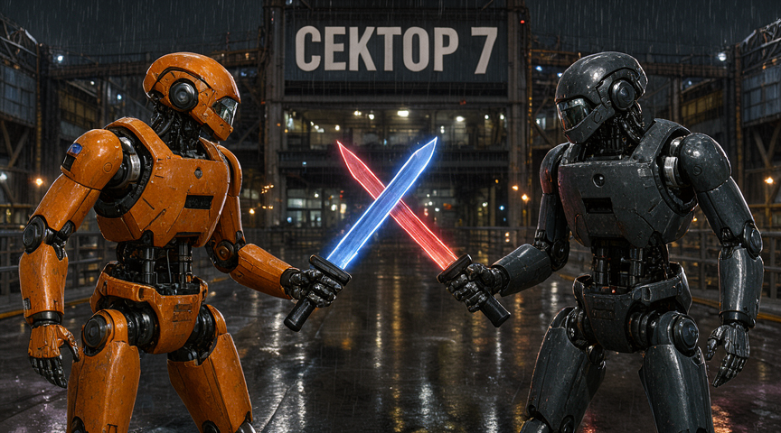

47.50 с; connection=PASS; instruction=FAIL; overall=FAIL.

У обоих персонажей видна непрерывная связь кисти, рукояти и клинка; подвешенного оружия не видно. Однако персонаж слева держит меч левой анатомической рукой вместо заданной правой. Фигуры дополнительно обрезаны снизу, хотя требовались полные тела.

[Точный промпт](../prompts/robot-battle-clear.txt) · [Параметры](../results/battle-robot-clear-123/record.json)

## battle-robot-original-7

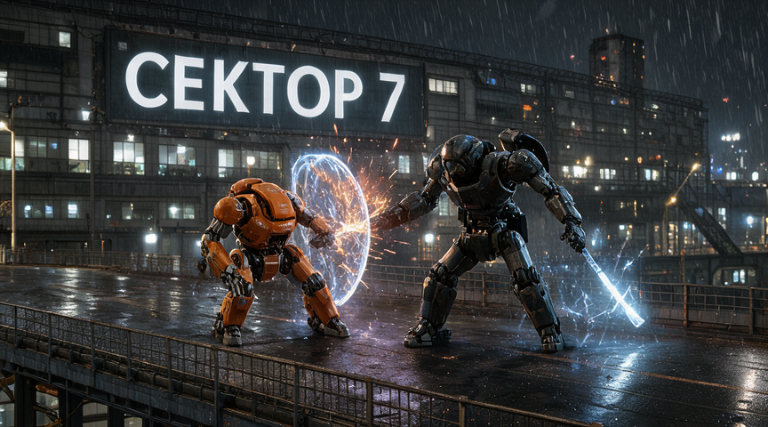

42.26 с; connection=PASS; instruction=FAIL; overall=FAIL.

Посох виден в опущенной руке тёмного робота справа, а в щит упирается другая рука. Хват оружия виден, но требуемого удара посохом по щиту нет.

[Точный промпт](../prompts/hitech-battle.txt) · [Параметры](../results/battle-robot-original-7/record.json)

## batch-hitech-battle

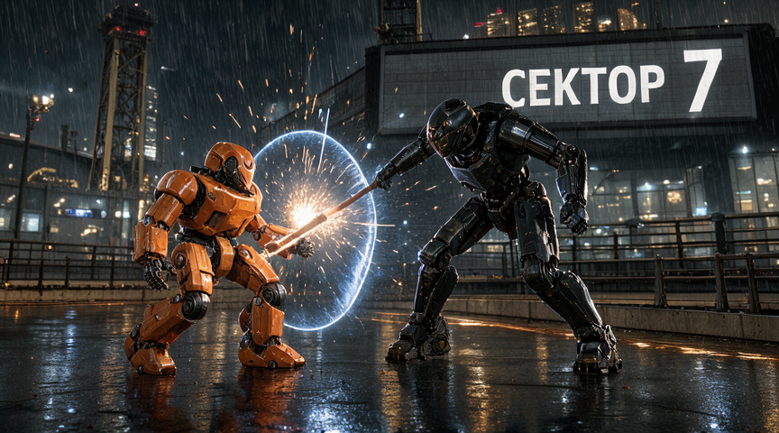

42.61 с; connection=UNCERTAIN; instruction=FAIL; overall=FAIL.

В области щита оранжевого робота светящийся стержень и его кисть сливаются с древком тёмного робота: принадлежность и конструкция не читаются надёжно. Замечание о странном оружии подтверждено. Исходный промпт задавал оранжевому щит, тёмному посох; отдельный левый меч не требовался.

[Точный промпт](../prompts/hitech-battle.txt) · [Параметры](../results/batch-hitech-battle/record.json)

## battle-robot-original-123

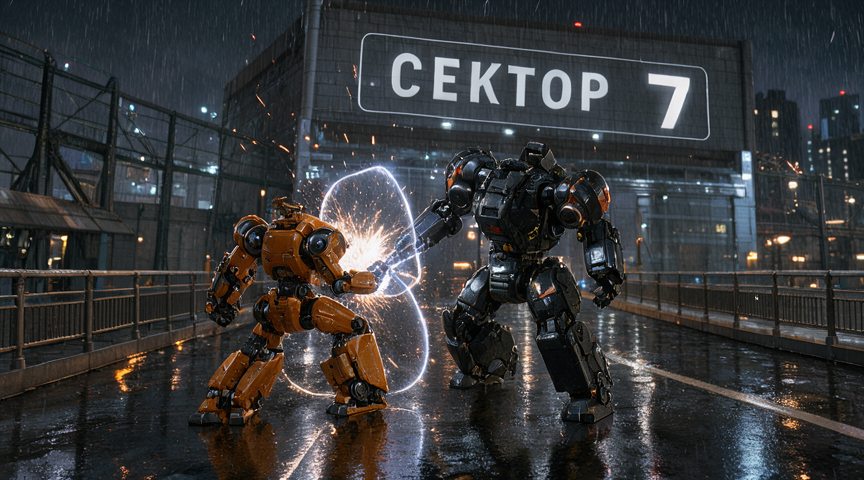

41.04 с; connection=FAIL; instruction=FAIL; overall=FAIL.

У тёмного робота нет различимого энергетического посоха: удар выглядит как контакт руки со щитом. Крупная надпись читается, но главное действие промпта отсутствует.

[Точный промпт](../prompts/hitech-battle.txt) · [Параметры](../results/battle-robot-original-123/record.json)

## battle-steampunk-clear-7

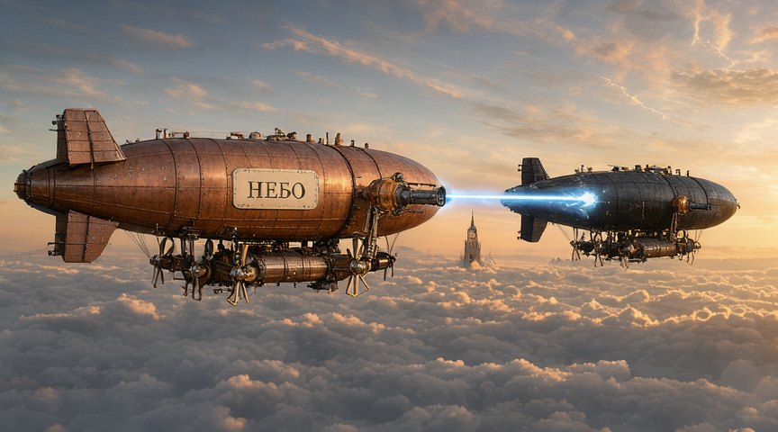

45.26 с; connection=PASS; instruction=FAIL; overall=FAIL.

Главный луч начинается у ствола и заканчивается на корпусе второго корабля, оба корабля целиком видны. Но излучатели расположены на оболочке, а не на кронштейнах гондол, как требовал уточнённый промпт. Улучшена читаемость атаки, не исполнены все ограничения.

[Точный промпт](../prompts/steampunk-battle-clear.txt) · [Параметры](../results/battle-steampunk-clear-7/record.json)

## battle-steampunk-clear-42

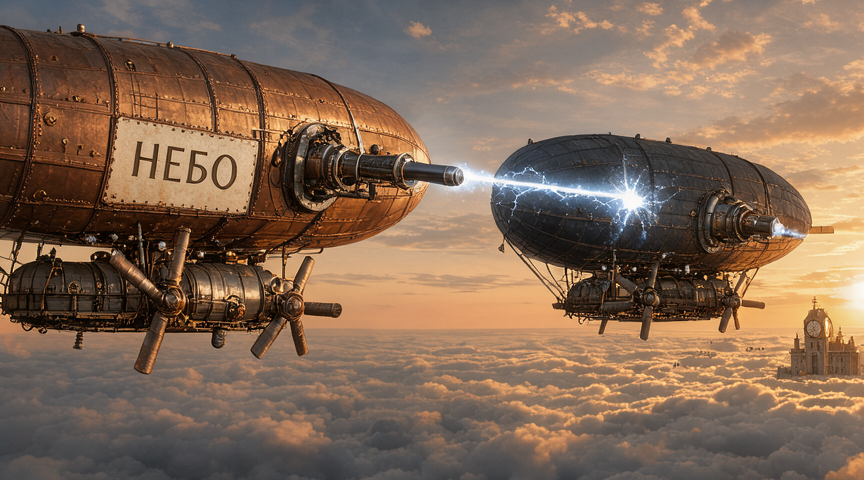

45.33 с; connection=PASS; instruction=FAIL; overall=FAIL.

Главный луч непрерывно идёт от левого ствола к корпусу правого корабля. Однако левый корабль обрезан, справа появился лишний луч, а излучатели закреплены на оболочках вместо заданных кронштейнов гондол.

[Точный промпт](../prompts/steampunk-battle-clear.txt) · [Параметры](../results/battle-steampunk-clear-42/record.json)

## batch-steampunk-battle

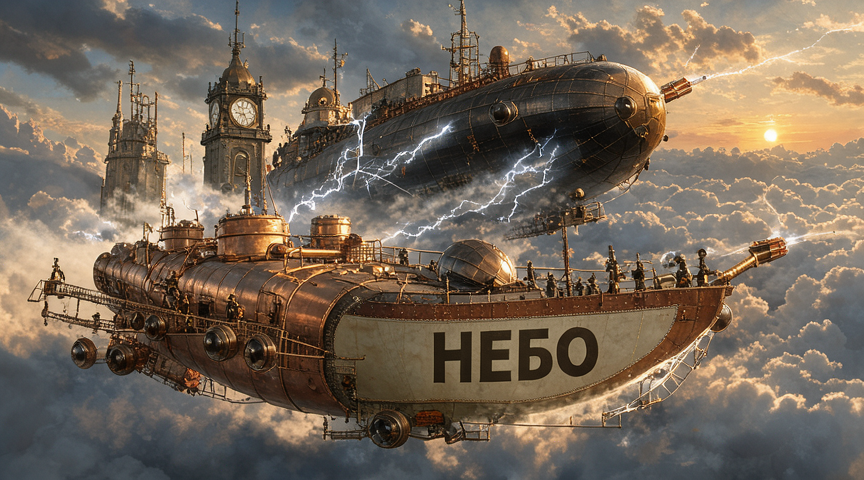

45.50 с; connection=UNCERTAIN; instruction=UNCERTAIN; overall=UNCERTAIN.

Дуги тянутся через область башни и обшивки; их концы нельзя надёжно сопоставить отдельным защитным устройствам каждого корабля. Эффектная композиция не доказывает согласованную механику оружия.

[Точный промпт](../prompts/steampunk-battle.txt) · [Параметры](../results/batch-steampunk-battle/record.json)

## Следующие опыты

Сначала сравнить captions официального prompt upsampler с текущими подробными промптами на тех же seed. Затем отдельно проверить постановку поз и размещение объектов, если выбранный backend действительно поддерживает соответствующий механизм. Inpainting/референсы и LoRA здесь не испытаны. Нельзя обещать, что увеличение шагов, разрешения или перенос кода управления памятью исправит хват: причинный опыт для этого ещё не выполнен.
