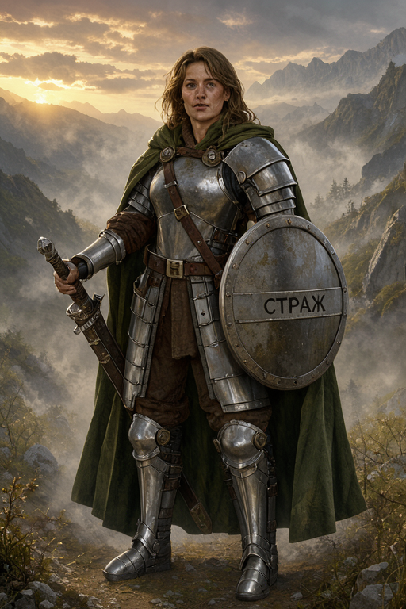
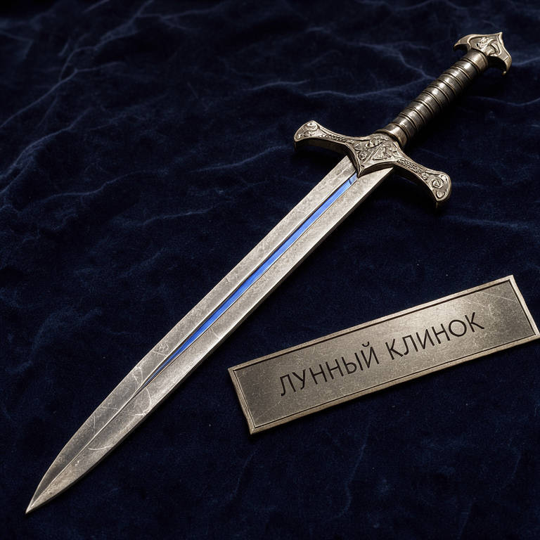
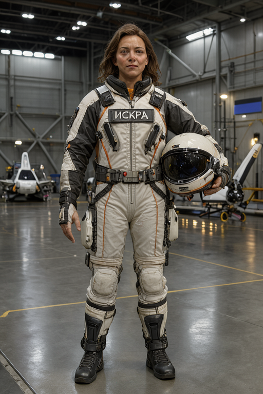
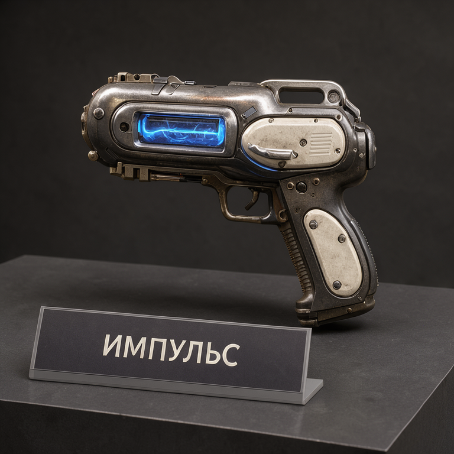
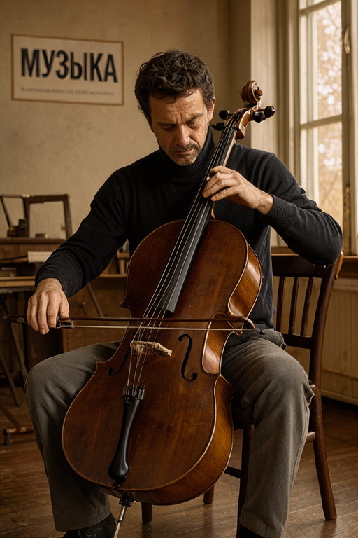
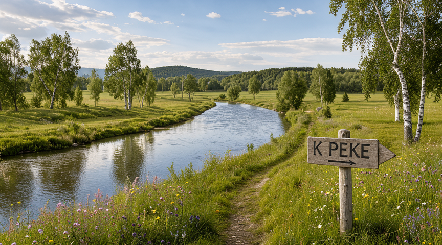
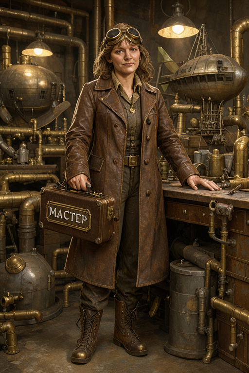
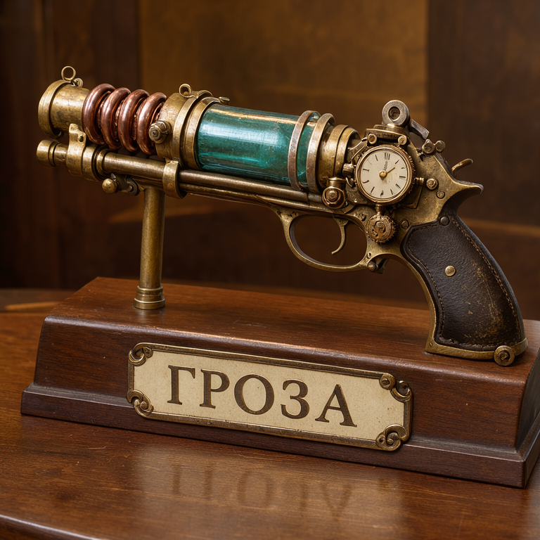
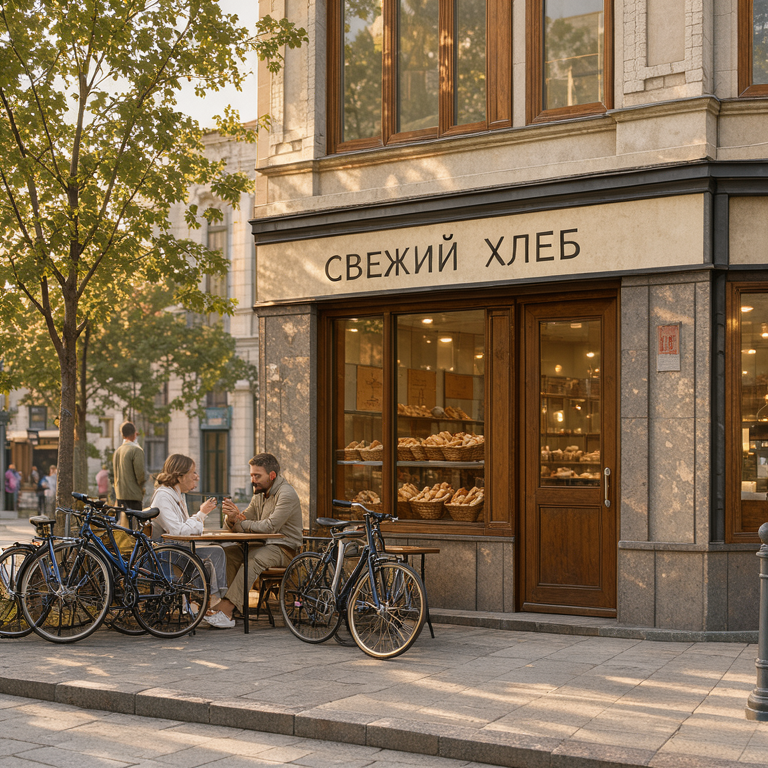

# Первые тематические результаты

Все исходные кадры сохранены, включая дефекты. Оценки качества – в visual-review.json.

## Фэнтези: Бой на крепостном мосту

864×480, seed 42, 42.68 с.

У правого воина кисти заняты щитом и опущенной рукой, а отдельный меч висит между фигурами без хвата. Это подтверждает замечание о неподдерживаемом клинке; кадр не проходит проверку физической связности.

## Фэнтези: Страж рассвета

512×768, seed 42, 41.80 с.

Надпись на щите читается, фигура показана целиком. Плащ, броня, меч в ножнах и горное окружение присутствуют. Один спокойный персонаж не доказывает устойчивость модели на сложных позах.

## Фэнтези: Звёздный предел

864×480, seed 42, 43.14 с.

Длинная надпись в две строки читается, включая Ё и Й. Замок, мост и глубина сцены присутствуют. Замок расположен на одной доминирующей скале; запрошенная структура между двумя пиками и водопады выражены не полностью.

## Фэнтези: Лунный клинок

768×768, seed 42, 60.06 с.

Оба слова читаются на наклонной табличке. Меч целиком помещается в кадре, фактура металла и бархата различима. Запрошенное навершие в форме полумесяца передано неявно.

## Хай-тек: Схватка машин

864×480, seed 42, 42.61 с.

В области щита оранжевого робота светящийся стержень и его кисть сливаются с древком тёмного робота: принадлежность и конструкция не читаются надёжно. Замечание о странном оружии подтверждено. Исходный промпт задавал оранжевому щит, тёмному посох; отдельный левый меч не требовался.

## Хай-тек: Пилот «Искра»

512×768, seed 42, 41.53 с.

Надпись на груди читается. Фигура и шлем видны целиком, материалы скафандра различимы. Пять отдельных пальцев на опущенной кисти не читаются достаточно отчётливо, поэтому точный счёт пальцев не подтверждён.

## Хай-тек: Станция «Орбита»

768×768, seed 42, 60.29 с.

Надпись читается. Панорамное окно, планета, растения и небольшие фигуры присутствуют. Табло занимает большую долю верхней части композиции.

## Хай-тек: Энергетический реквизит

768×768, seed 42, 59.79 с.

Надпись читается. Форма предмета и светящаяся камера различимы. Материалы сдвинуты к потёртому металлу и ретрофутуризму; запрошенные керамические панели выражены слабо.

## Персоны: Музыкант с виолончелью

512×768, seed 42, 42.87 с.

Основное слово читается. Под ним добавлена незапрошенная мелкая строка, содержание неразборчиво. Низ фигуры и инструмента тесно обрезан; условие полного роста соблюдено не полностью. Обе кисти видны, точность техники игры отдельно не подтверждена.

## Персоны: Портрет мастерицы

768×768, seed 42, 59.19 с.

Фотореалистичный портрет: читаются текстура кожи, волосы и мягкий свет из окна. Кисти рук не входят в кадр; этот опыт не проверяет анатомию рук.

## Загородный пейзаж: Летняя река

864×480, seed 42, 45.48 с.

Надпись читается. Указатель показывает вправо, тогда как видимая река находится слева от него: направление к воде не соблюдено. Река, растительность и дальние планы различимы.

## Загородный пейзаж: Зимний дом у леса

864×480, seed 42, 46.36 с.

Надпись читается, две точки над Ё видны. Снег, тёплые окна и дым присутствуют; табличка заметно занимает передний план.

## Стимпанк: Воздушный бой

864×480, seed 42, 45.50 с.

Дуги тянутся через область башни и обшивки; их концы нельзя надёжно сопоставить отдельным защитным устройствам каждого корабля. Эффектная композиция не доказывает согласованную механику оружия.

## Стимпанк: Механик воздушного порта

512×768, seed 42, 40.31 с.

Надпись на кейсе читается. Фигура, очки, кейс и рабочая поверхность представлены. Костюм и мастерская выдержаны в теме; точная механика декоративных устройств не оценивается.

## Стимпанк: Паровой порт

864×480, seed 42, 42.96 с.

Оба слова читаются. Дирижабли, башни, трубы и пар присутствуют. Сцена насыщена мелкими механизмами, конструкционная правдоподобность которых не подтверждена.

## Стимпанк: Медный реквизит «Гроза»

768×768, seed 42, 62.29 с.

Надпись читается. Медные катушки, стеклянная камера, кожа и деревянная подставка переданы. На циферблате появляются дополнительные мелкие обозначения; это декоративный вымышленный реквизит, его техническая работоспособность не оценивается.

## Городской пейзаж: Площадь с пекарней

768×768, seed 42, 61.29 с.

Оба слова читаются. Витрина с хлебом и утренний свет присутствуют. В группе велосипедов мелкие детали пересекаются и перегружены; точная геометрия каждого велосипеда не подтверждена.

## Городской пейзаж: Москва после дождя

864×480, seed 42, 49.10 с.

Крупная надпись читается. Дождь, трамвай и отражения соответствуют теме. На фоне добавлены мелкие вывески и обозначения. Соответствие реальной улице Москвы не проверялось; это иллюстративная локализация.
